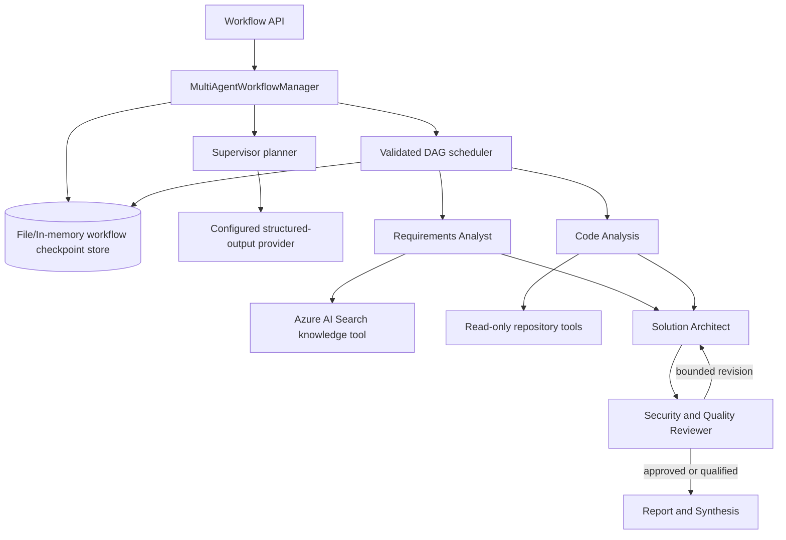

# Assessment 08 — Multi-Agent Orchestration Evaluation

Date: 2026-10-18  
Status: implementation and automated evaluation complete; live Foundry recovery evaluation recorded below

## 1. Assessment objectives

Assessment 08 adds a bounded, durable, read-only multi-agent workflow to the existing ASP.NET Core solution. It reuses the Foundry structured-output and tool-calling clients, Azure AI Search knowledge retrieval, repository boundary, and Assessment 07 persistence patterns. The implementation provides six logical roles, model-based planning, validated DAG execution, controlled concurrency, independent review, bounded revisions, evidence provenance, restart recovery, and safe APIs without introducing another service, write tool, API key, LangChain, LangGraph, or MCP dependency.

## 2. Architecture



Clean Architecture remains intact: workflow contracts and policy are in `AgentForge.Application`, file persistence and provider/tool adapters are in `AgentForge.Infrastructure`, and HTTP/DI composition is in `AgentForge.Api`.

## 3. Agent responsibilities

| Logical role | Responsibility | Tools |
|---|---|---|
| Supervisor | Generate the smallest useful task DAG and coordinate execution | None |
| Requirements Analyst | Retrieve documented requirements, policy, ambiguities, and acceptance criteria | `search_project_knowledge` |
| Code Analysis | Inspect implementation and integration points | `list_files`, `search_code`, `read_file` |
| Solution Architect | Combine validated findings into designs and trade-offs | None |
| Security and Quality Reviewer | Independently approve, qualify, reject, or request a bounded revision | None |
| Report and Synthesis | Produce the reviewed final Markdown report | None |

These are in-process logical agents. They share infrastructure but not model conversations or tool permissions.

## 4. Supervisor planning

`SupervisorWorkflowPlanner` asks the configured structured-output model for the smallest useful plan. It does not use keyword routing. `WorkflowPlanValidator` then treats that plan as untrusted input and rejects unknown roles, Supervisor delegation, duplicate tasks or roles, invalid identifiers, missing/self dependencies, cycles, excessive task count/depth, architecture without review, and reports that bypass review. The original user objective replaces any model-rewritten objective.

Two different valid shapes are exercised: a five-specialist M1 plan and a narrow one-specialist Requirements plan. This demonstrates dynamic planning without allowing the model to redefine policy.

## 5. Agent communication contracts

The principal typed contracts are `WorkflowPlan`, `PlannedAgentTask`, `WorkflowTaskState`, `AgentTaskOutput`, `AgentTaskMetrics`, `WorkflowMessage`, and `MultiAgentWorkflowCheckpoint`. Messages carry schema version, workflow/task IDs, sender, recipient, message type, correlation ID, bounded summary, evidence IDs, and timestamp. Dependencies pass structured outputs, not a shared mutable chat transcript.

Role-specific JSON schemas narrow control fields. Only the Reviewer schema exposes review decisions and revision fields; only Report Synthesis can return a report. Optional blank strings from a provider are normalized to null before policy checks.

## 6. Tool permission matrix

| Role | Knowledge | Repository read | Shell/write/deploy |
|---|---:|---:|---:|
| Supervisor | No | No | No |
| Requirements Analyst | Yes | No | No |
| Code Analysis | No | Yes | No |
| Solution Architect | No | No | No |
| Security Reviewer | No | No | No |
| Report Synthesis | No | No | No |

The engine filters tool definitions before every model call and rejects any requested tool outside the role allow-list. Repository access still passes through the configured allow-root, ignored-directory, extension, size, traversal, symlink, and sensitive-file controls from Assessment 04/06.

## 7. Workflow state machine

Workflow states are `Created`, `Planning`, `Running`, `WaitingToResume`, `Completed`, `CompletedWithConcerns`, `InsufficientEvidence`, `Failed`, and `Cancelled`. Task states are `Pending`, `Running`, `Completed`, `Failed`, and `Cancelled`. `WorkflowStateMachine` explicitly permits only documented transitions. Terminal workflows are idempotent and cannot be re-executed.

Transient provider, timeout, rate-limit, unavailable, and storage failures release execution to `WaitingToResume`. Permanent invalid plan/output/tool/request failures terminate safely. Cancellation increments the fencing token so an old executor cannot commit.

## 8. Durable workflow schema

Each checkpoint contains the schema version, workflow objective and plan, per-task status/output/history/metrics, messages, evidence registry, aggregate calls/tokens/duration, revision/resume counters, owner lease, fencing token, review/termination outcome, final report, failure classification, and optimistic-concurrency version.

The file provider stores a bounded JSON envelope containing a Base64 payload plus SHA-256 checksum. Deserialization disallows unmapped members, validates required constructor members and enum strings, checks the checksum and schema version, and then applies semantic checkpoint validation. Writes use compare-and-swap versions and atomic replacement. `InMemoryWorkflowCheckpointStore` provides the same contract for tests.

## 9. Dependency scheduling

The scheduler derives ready tasks only when all declared dependencies are completed. It takes at most `MaxConcurrency`, marks the selected tasks running in one committed checkpoint, runs them with isolated contexts, and commits each result as it finishes. If no task is schedulable while work remains, the workflow terminates rather than spin. A validated acyclic plan and bounded dependency depth prevent deadlock by construction.

## 10. Parallel execution

Requirements and Code Analysis have no dependency on each other in the M1 plan, so both begin in the same scheduler wave. `Task.WhenAny` commits whichever finishes first without waiting to save the peer. The Architect does not become ready until both completed results are durable. Automated overlap tests use barriers and timestamps, not only task ordering.

## 11. Review and revision

Architecture and final reporting cannot bypass Security Reviewer. Review outcomes are `Approved`, `ApprovedWithConcerns`, `RevisionRequired`, and `InsufficientEvidence`. A revision must name a direct reviewer dependency and supply a reason. The target output is preserved in `PreviousOutputs`, the target and reviewer return to pending, downstream report output is cleared, and the revision counter increments. At the configured limit, the workflow produces `ApprovedWithConcerns` instead of looping.

## 12. Evidence provenance

Knowledge evidence IDs are chunk citations such as `knowledge:authentication.md#chunk-1`. Repository evidence IDs are normalized paths such as `repo:src/AgentForge.Api/Program.cs`. Tool results add IDs to the workflow registry. A specialist may cite only an ID already in its dependency context or returned by its authorized tools; duplicates and fabricated IDs are rejected. Provenance proves source lineage, not that a claim is semantically correct, so the prompts and Reviewer retain uncertainty.

## 13. Cross-agent prompt-injection protection

Application-owned role policy is always a system message. The objective, task JSON, knowledge text, repository content/comments, and dependency outputs are explicitly labeled untrusted. They cannot change the role, tools, workflow policy, budgets, recipients, storage, or review requirement. Tool allow-lists are enforced in code. Downstream agents receive only structured dependency outputs and validated evidence. Tests cover malicious text in knowledge, repository content, and agent-to-agent output.

## 14. API contracts

| Method | Route | Result |
|---|---|---|
| POST | `/api/workflows` | Create a workflow; returns `201` and Location |
| GET | `/api/workflows/{workflowId}` | Safe status, task metrics, counters, and outcome |
| POST | `/api/workflows/{workflowId}/resume` | Acquire ownership and continue |
| POST | `/api/workflows/{workflowId}/cancel` | Cancel and fence the active owner |
| GET | `/api/workflows/{workflowId}/report` | Return the completed report or conflict |

The response deliberately excludes prompts, tool result bodies, raw checkpoint payloads, credentials, and chain-of-thought. Swagger includes all workflow routes.

## 15. M1–M10 results

| Scenario | Input/plan and execution | Evidence, usage, outcome | Result |
|---|---|---|---|
| M1 full workflow | Exact required password-reset request; Foundry produced Requirements + Code → Architect → Reviewer → Report | 19 model calls, 9 tool calls, 83,571 tokens; reviewed 7,844-character report | Pass live, qualified as `InsufficientEvidence` |
| M2 dynamic planning | Narrow documented-requirements objective; one Requirements task in the automated planner fixture | Unnecessary roles not invoked; no report/architecture means no mandatory reviewer edge | Pass (automated) |
| M3 parallel execution | Full DAG fixture | Requirements and Code overlap; Architect starts only after both; isolated outputs | Pass (automated and observed live) |
| M4 reviewer revision | Controlled Reviewer output targets Architect | Prior Architect output retained and Reviewer reevaluates; live M1 performed two bounded revisions then retained concerns | Pass (automated and live) |
| M5 insufficient evidence | Unknown feature fixture | No fabricated evidence; terminal `InsufficientEvidence`; live M1 also qualified missing implementation artifacts | Pass (automated and live) |
| M6 cross-agent injection | Malicious knowledge, repository, and dependency strings | No unauthorized tool; no policy/review bypass | Pass (automated) |
| M7 restart/recovery | Actual API process killed after Supervisor, Requirements, and Code were committed | Checkpoint v11 retained 12 model calls, 9 tool calls, 27,438 tokens, and 21 evidence IDs; new process recovered to fence 4 and did not rerun completed tasks | Pass live |
| M8 concurrency | Two resume attempts against active owner | One owner; second receives conflict; CAS/fencing tests preserve state | Pass (automated) |
| M9 budget exhaustion | Low workflow-wide model budget and bounded revision fixtures | Safe `MaxBudgetReached`/qualified termination; no unbounded loop | Pass (automated) |
| M10 regression | Complete solution suite | 212-test baseline plus 73 Assessment 08 tests | Pass: 285 total (final run below) |

## 16. Automated test summary

The Assessment 08 suite contains 73 cases across plan validation, role permissions, schema boundaries, injection handling, citations, scheduling, overlap, revision, insufficient evidence, partial failure, recovery, concurrency, cancellation, budgets, persistence, corruption, state transitions, provider protocol, API routes, and Swagger. It includes regression coverage for live-discovered defects: usage from failed attempts remains accountable; retry attempts are independent from review revisions; no-tool turns omit `parallel_tool_calls`; and the final allowed model turn retains tool definitions while setting `tool_choice: none` so Foundry must return the structured result.

Final commands and results are recorded in section 18. The existing 212-test baseline was not reduced.

## 17. Live Foundry evaluation

Configuration used the existing `agentforge-gpt5-mini` deployment, `text-embedding-3-small`, Azure AI Search, `DefaultAzureCredential`, a persistent local checkpoint directory, a 300-second lease, and the repository root supplied through `RepositoryAnalysis__AllowedRoot`. No API key, RBAC change, or Azure resource mutation was made.

The exact M1 input was:

> Analyze password reset requirements and repository implementation, propose architecture improvements, identify security risks, and produce a technical report.

The final run ID was `f909ecc34ba247cfa61a5524cb01cf97`. Foundry generated `reqs` and `code` as independent tasks, `arch` depending on both, `secrev` depending on `arch`, and `report` depending on `secrev`. Requirements and Code ran concurrently. Before the controlled restart, durable checkpoint version 11 contained completed Supervisor, Requirements, and Code tasks, 12 model calls, 9 tool calls, 27,438 total tokens, and 21 validated evidence IDs. The actual API process was terminated.

A fresh ASP.NET Core process opened the same checkpoint directory. After the prior lease expired, it recovered the workflow to `WaitingToResume`, advanced the fencing token from 2 to 4, reset only the interrupted Architect from running to pending, and kept Requirements and Code completed with their original attempt counts and outputs. Neither completed specialist was called again. Execution then continued through Architect, Reviewer, two Reviewer-requested Architect revisions, Reviewer qualification at the revision limit, and Report Synthesis.

The terminal checkpoint was version 46 with status `InsufficientEvidence`, review outcome `ApprovedWithConcerns`, termination reason `InsufficientEvidence`, two revisions, 19 model calls, 9 tool calls, 56,392 input tokens, 27,179 output tokens, 83,571 total tokens, 789,743 ms recorded execution duration, 21 evidence IDs, 31 workflow events, and a 7,844-character final report. This is a successful qualified outcome: the agents did not invent missing migrations, token persistence, session model, key-management detail, or concurrency proof.

Earlier diagnostic runs are retained as limitations/evidence rather than presented as passes:

- A 15-second lease expired during a 138-second planning call; the stale worker was correctly fenced.
- Missing `RepositoryAnalysis:AllowedRoot` caused a permanent `InvalidRequest`; the live environment was then configured explicitly.
- Shared reviewer fields allowed Requirements to return a reviewer-only outcome; role-specific schemas fixed this defect.
- A failed specialist attempt originally lost usage; partial attempt metrics are now persisted.
- Removing tool definitions on a final turn caused Foundry HTTP 400 because prior tool-call messages referred to those tools. The corrected protocol keeps definitions and sends `tool_choice: none`.
- Sending `parallel_tool_calls: false` to a no-tool role caused Foundry HTTP 400; the protocol now emits that option only when tools exist.
- The original checkpoint validator coupled transient task attempts to revision cycles. A separate bounded `MaxTaskAttempts` policy now governs retries.

## 18. Performance and token usage

The Supervisor planning calls in the diagnostic/live runs took approximately 134–139 seconds on the configured Foundry deployment. Knowledge retrieval combined one embedding request and SemanticHybrid Azure AI Search; observed retrieval was about 6 seconds. Repository tools themselves completed in single- or double-digit milliseconds; model turns dominated latency.

At the controlled M7 boundary: 12 model calls, 9 tool calls, 27,438 total tokens, 21 evidence IDs, and checkpoint version 11 were durable. At terminal version 46: 19 model calls, 9 tool calls, 83,571 tokens, 789,743 ms, two revisions, 21 evidence IDs, and 31 events. Requirements used `search_project_knowledge` once (5,018 tokens, 32,074 ms). The successful Code attempt used four `search_code` calls (15,529 tokens, 161,616 ms). The final successful Architect, Reviewer, and Report calls used 10,465/9,499/6,814 tokens and 21,606/23,846/32,929 ms respectively. Aggregate totals also include failed/transient attempts, so they intentionally exceed the sum of the latest successful per-task metrics.

Failed attempts contribute their available model calls, tool calls, input/output/total tokens, duration, and produced evidence to workflow budgets. Null token fields remain null rather than pretending the provider reported zero.

Final verification:

```text
dotnet test AgentForge.sln --no-restore --configuration Release
Result: 285 passed, 0 failed, 0 skipped

dotnet format AgentForge.sln --verify-no-changes --no-restore
Result: passed, no changes required

dotnet build AgentForge.sln --no-restore --configuration Release /warnaserror
Result: succeeded, 0 warnings, 0 errors
```

No Git command was executed, per instruction.

## 19. Known limitations

- File checkpoints support a single shared filesystem/process topology; production scale-out should use a transactional distributed store.
- A killed worker remains protected by its existing lease until expiry. This delays takeover but prevents two executors from committing.
- Cancellation cannot undo a provider request already in flight; fencing prevents its late result from being committed.
- Provider latency and throttling remain external variables. Retries are bounded by the existing provider policy and attempt timeout.
- Dynamic planning is probabilistic, although the resulting plan is deterministic after strict validation.
- Citation validation establishes provenance/authorization, not full natural-language entailment.
- The repository allow-root must be configured for the deployment environment. It is intentionally not inferred from arbitrary user input.
- The file store does not encrypt payloads itself; deployment storage permissions/encryption remain operational responsibilities.

## 20. Files added or modified

Added:

- `src/AgentForge.Application/MultiAgent/WorkflowModels.cs`
- `src/AgentForge.Application/MultiAgent/WorkflowContracts.cs`
- `src/AgentForge.Application/MultiAgent/MultiAgentWorkflowOptions.cs`
- `src/AgentForge.Application/MultiAgent/WorkflowPlanValidator.cs`
- `src/AgentForge.Application/MultiAgent/WorkflowSchemas.cs`
- `src/AgentForge.Application/MultiAgent/SupervisorWorkflowPlanner.cs`
- `src/AgentForge.Application/MultiAgent/SpecialistAgentEngine.cs`
- `src/AgentForge.Application/MultiAgent/WorkflowStateMachine.cs`
- `src/AgentForge.Application/MultiAgent/WorkflowCheckpointValidator.cs`
- `src/AgentForge.Application/MultiAgent/MultiAgentWorkflowManager.cs`
- `src/AgentForge.Infrastructure/MultiAgent/WorkflowCheckpointJson.cs`
- `src/AgentForge.Infrastructure/MultiAgent/InMemoryWorkflowCheckpointStore.cs`
- `src/AgentForge.Infrastructure/MultiAgent/FileWorkflowCheckpointStore.cs`
- `src/AgentForge.Api/Contracts/CreateWorkflowRequest.cs`
- `src/AgentForge.Api/Controllers/WorkflowsController.cs`
- `src/AgentForge.Api/Composition/MultiAgentWorkflowComposition.cs`
- `tests/AgentForge.Tests/MultiAgent/WorkflowPlanAndStoreTests.cs`
- `tests/AgentForge.Tests/MultiAgent/MultiAgentWorkflowManagerTests.cs`
- `tests/AgentForge.Tests/MultiAgent/SpecialistAgentSecurityTests.cs`
- `tests/AgentForge.Tests/MultiAgent/WorkflowEndpointTests.cs`
- `tests/AgentForge.Tests/MultiAgent/ChatToolCallingProtocolTests.cs`
- `docs/assessment-08-evaluation.md`

Modified:

- `src/AgentForge.Application/Agents/ToolCallingContracts.cs`
- `src/AgentForge.Infrastructure/ToolCalling/ChatToolCallingProtocol.cs`
- `src/AgentForge.Api/Program.cs`
- `src/AgentForge.Api/appsettings.json`

## 21. Readiness

Assessment 08 meets the requested in-process multi-agent boundaries, durability, evidence, review, API, and automated-test requirements. Readiness for a later assessment is contingent on reviewer acceptance of this implementation and report; no next assessment was started.

## Assessment 08 — Learning Report

### 1. What is a multi-agent AI system?

It is a system in which multiple role-bounded reasoning components collaborate through explicit tasks and messages. AgentForge uses Supervisor, Requirements, Code, Architect, Reviewer, and Report roles, each with a distinct prompt, contract, and permission set.

### 2. How is it different from one agent with many tools?

A single agent owns one context and selects among all tools. AgentForge separates context, authority, outputs, and accountability: the Requirements agent cannot inspect files, the Code agent cannot query knowledge, and the Reviewer has no tools and independently judges prior outputs.

### 3. What is a Supervisor Agent?

It translates an objective into a bounded dependency plan and coordinates execution. AgentForge’s Supervisor proposes a structured plan but application code validates it; the Supervisor cannot execute tools or override policy.

### 4. What is agent delegation?

Delegation assigns a scoped objective to a role with an explicit dependency set and budget. For M1, the Supervisor delegates documented policy retrieval to Requirements and implementation inspection to Code in parallel.

### 5. What is an agent task?

It is a durable unit containing task ID, role, objective, dependencies, state, attempt count, output history, metrics, and failure classification. It is smaller and more controllable than giving an agent the entire user request.

### 6. How do agents communicate?

They exchange typed `WorkflowMessage` records and structured dependency outputs through the checkpoint. They do not share a free-form chat or call each other directly.

### 7. Do agents need separate APIs?

No. Logical agents can run behind one API and one process, as AgentForge does. Separate APIs are useful only when scaling, isolation, ownership, or deployment boundaries justify the operational cost.

### 8. Do agents need separate LLM deployments?

No. AgentForge reuses the configured deployment and differentiates roles through system policy, schemas, tools, and context. Separate deployments may later optimize cost, latency, capability, or compliance per role.

### 9. How does the Supervisor decide which agent to call?

The model reads the objective and registered-role descriptions, proposes the smallest plan, and returns strict JSON. Code then validates role names, dependencies, DAG properties, bounds, and mandatory review.

### 10. What is dynamic planning?

The plan shape is generated for the objective instead of being a fixed pipeline. A requirements-only question can use one specialist, while M1 uses five specialists; both must satisfy invariant application policy.

### 11. What is a dependency graph?

It maps each task to prerequisites. In M1, Architect depends on Requirements and Code; Reviewer depends on Architect; Report depends on Reviewer.

### 12. What is a DAG?

A directed acyclic graph has directed dependencies and no cycles. A DAG gives AgentForge a finite topological execution order and exposes independent work that can run concurrently.

### 13. How do agents run in parallel?

The scheduler selects multiple ready tasks up to `MaxConcurrency` and starts their tasks together. It uses `Task.WhenAny` so each completed output is checkpointed immediately.

### 14. How are dependent agents scheduled?

A pending task is ready only when every ID in `DependsOn` is completed. Architect therefore waits even if Requirements finishes while Code is still running.

### 15. What is shared workflow state?

It is the durable checkpoint containing the plan, task states and outputs, evidence registry, counters, review status, ownership, and history. Agents receive snapshots derived from it rather than mutate it directly.

### 16. Why separate conversation contexts?

They reduce privilege bleed, prompt-injection propagation, irrelevant tokens, and accidental reliance on another role’s private scratch context. Code sees its task and tool history; Reviewer sees structured outputs, not raw Code-agent conversation.

### 17. How do we prevent cross-agent prompt injection?

Treat every user, tool, file, knowledge, and dependency payload as untrusted data; keep role policy in system messages; expose only role tools; validate outputs and citations; and enforce review/dependency rules in code.

### 18. What is independent agent review?

The Reviewer is a separate role with no implementation tools and a distinct schema. It checks evidence, security, reliability, policy, and suspicious instructions rather than letting the Architect approve itself.

### 19. How do bounded revision loops work?

Reviewer can request one specific dependency revision with a reason. AgentForge preserves the previous output, reruns the target and Reviewer, and caps cycles. At the limit it terminates with concerns instead of looping.

### 20. How are budgets enforced across agents?

Options cap planned tasks, depth, concurrency, specialist model calls, workflow model/tool calls, tokens, output/checkpoint size, events, revisions, leases, and attempt duration. Failed attempts also consume recorded budget. The last specialist model turn uses `tool_choice: none` so a final answer fits the call budget.

### 21. How does checkpointing work?

State is saved after creation, ownership acquisition, planning, task start, every task completion/failure, review decision, revision, and termination. Each write requires the expected version and, during execution, the current owner/fencing token.

### 22. How do we recover after a crash?

A new process loads the same checkpoint. After the prior lease expires, it converts stale running tasks back to pending, increments the fence, acquires a new owner, and resumes only unfinished work.

### 23. How do we prevent completed agents from running again?

The ready-task query selects only `Pending` tasks. Completed outputs are durable and included as dependencies; resume never changes a completed task to pending except an authorized bounded revision target.

### 24. How do we handle an agent failure?

Classify it. Transient provider/storage/timeouts return the workflow to resumable state after peer results are committed. Invalid output/tool/request failures fail safely. Partial attempt usage and evidence are still checkpointed.

### 25. How do we validate citations across agents?

Authorized tools produce normalized evidence IDs. The engine maintains an allowed set from dependencies plus current tool results and rejects output containing any other ID. Downstream agents can only reuse IDs in the durable registry.

### 26. How do we trace which agent produced a finding?

Every task output is stored under a task ID and role; messages include sender/recipient and correlation ID; metrics identify provider/model/tools; evidence IDs identify source chunks or paths.

### 27. Orchestration versus choreography?

Orchestration has a central coordinator deciding order and recovery; AgentForge uses this model. Choreography lets components react to events without one central scheduler, which increases decoupling but makes global policy, ordering, and debugging harder.

### 28. When should we use Azure Service Bus?

Use it when agents become independently deployed workers, tasks are long-running, load must be buffered, or durable cross-service delivery/dead-lettering is required. It is unnecessary for the current single-process bounded workflow.

### 29. When should agents use Azure Container Apps?

Use separate apps when roles need independent scaling, network identity, resource profiles, release cadence, or fault isolation. Do not split six roles merely because they are called agents; that would add distributed-system cost without current benefit.

### 30. How would LangGraph represent this workflow?

Conceptually, roles would be graph nodes, dependencies conditional edges, checkpoint state graph state, and Reviewer revision a bounded conditional back-edge. AgentForge implements the same core ideas directly in typed .NET without adding LangGraph.

### 31. Advantages and limitations of native .NET

Advantages are strong typing, direct ASP.NET/DI/Azure integration, explicit security policy, familiar testing, and no additional orchestration dependency. Limitations are more custom scheduler/checkpoint code and fewer ready-made visualization, graph, and human-in-the-loop facilities.

### 32. What changes for production multi-tenancy?

Add tenant/user identity to every API, task, evidence item, and partition key; authorize repository/index access per tenant; use managed identity and tenant-scoped encryption; move checkpoints to a distributed transactional store; add quotas, idempotency keys, queue-based workers, audit retention, content isolation, regional/data-residency policy, observability, cost attribution, secret rotation, and tenant-aware deletion/export. Ownership and CAS must include the tenant partition so one tenant can never resume or cite another tenant’s workflow.
