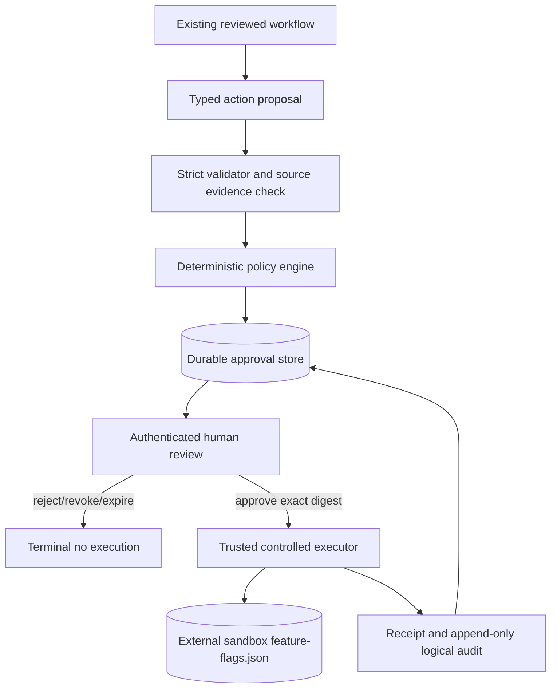

# Assessment 10 — Human-in-the-Loop Approvals, Policy Enforcement, Controlled Actions, and Durable Recovery

Date: 2026-10-22  
Status: **Qualified** — implementation and deterministic evaluation complete; production Entra ID and a live OS-level API restart were not executed.

## 1. Objectives

Assessment 10 introduces an application-enforced action boundary in which an agent or requester can propose data, but cannot approve or execute it. Trusted .NET code validates the proposal and source evidence, evaluates deterministic policy, binds approval to an exact digest, records an authorized human decision, and permits only a registered sandbox executor. Existing repository/knowledge tools remain read-only and were not given any write capability.

## 2. Architecture



The HITL implementation is a durable action subworkflow linked by `WorkflowId` and `TaskId`. It does not duplicate or modify the multi-agent scheduler. A proposal can reference only a completed workflow task and evidence already present on that task. This preserves ordinary analysis behavior and gives action state an independent lease, fence, journal, receipt, and audit lifecycle.

## 3. Proposal contract and model boundary

`AgentActionProposal` contains only workflow/task IDs, registered action type, logical target, JSON parameters, justification, and evidence IDs. `ActionProposalSchema.Json` is a strict model-facing schema with `additionalProperties: false`. It exposes no approval state, actor identity, expiry, policy/risk, operation ID, idempotency key, executor, sandbox path, storage provider, or permission scope.

The public DTO similarly omits server-owned fields. Extra caller fields cannot be mass-assigned. The authenticated identity always comes from the validated principal; request-body `approverId` values are ignored and tested.

## 4. Registered action

The only registered mutation is `UpdateSandboxFeatureFlag` targeting logical ID `sandbox-feature-flags`. Its parameters must contain exactly:

```json
{
  "flagName": "enable-demo-feature",
  "enabled": true
}
```

The flag must be configured in `HumanApproval:AllowedFlagNames`; unknown fields, strings in place of booleans, path properties, unknown flags, action types, and targets are rejected. The executor independently rechecks action type, target, and flag allow-list. There is no shell, arbitrary path, arbitrary HTTP request, source write, Git action, deployment, secret action, or Azure mutation.

Relative sandbox/storage settings resolve below the operating-system temporary directory, not the application content root. With the shipped Windows settings the logical roots are `%TEMP%\AgentForge\action-sandbox` and `%TEMP%\AgentForge\approvals`; in a container they resolve below `/tmp/AgentForge`. Absolute paths can be configured, but composition rejects any path beneath the application repository. Reparse points, symbolic links, and junctions on the sandbox path are rejected.

## 5. Deterministic policy

`DeterministicActionPolicyEvaluator` recognizes only the registered sandbox mutation, logical target, allow-listed flag, nonempty tenant, and a caller with proposal permission. Every accepted change is `Medium` risk and requires `HumanFourEyes` approval for 30 minutes under policy `A10-v1`. The model cannot lower risk or select policy fields.

Policy is checked at creation, human decision, and execution. Historical records retain their original policy version and remain readable after an upgrade; a current-policy version mismatch prevents approval/execution and requires a new request.

## 6. Authentication and authorization

All approval endpoints use ASP.NET Core authentication and policy authorization. Required permission claims are:

- `ActionProposal.Create` and `ActionProposal.Read`;
- `ActionApproval.Review`, `ActionApproval.Approve`, and `ActionApproval.Reject`;
- `ControlledAction.Execute`; and
- `ActionAudit.Read`.

The local handler accepts only fixed server-mapped development bearer identities and is enabled only when the host is Development/Test **and** `DevelopmentAuthentication:Enabled` is true. A test proves that setting the option in Production still leaves development credentials disabled. Identity, actor type, tenant, and permissions are derived from claims, never `X-User-Id` or request fields.

Production does not have a fallback identity. It must replace the local scheme with Microsoft Entra ID JWT bearer validation, configured tenant/audience/issuer, app roles or scopes, and resource/tenant authorization. No app registration, tenant ID, client ID, secret, role assignment, or live Entra integration was created or claimed.

Proposal creation and approval authority are separate. Agent identities cannot approve even if a forged permission reaches the service. A human requester cannot approve their own proposal. Review, approval, rejection, execution, and audit access are each enforced at both HTTP and application boundaries.

## 7. Lifecycle

Validation and policy evaluation occur before persistence, so invalid proposals never become durable. The persisted state machine is:

```text
PendingApproval -> Approved -> Executing -> Executed
       |              |            |          
       |              |            +-> ExecutionFailed
       |              |            +-> ExecutionUncertain
       |              +-> Revoked
       |              +-> Expired
       +-> Rejected
       +-> Revoked
       +-> Expired
```

Transition code rejects every unlisted edge. Duplicate approval/rejection by the same reviewer is idempotent; competing decisions use optimistic concurrency and only one commits. Terminal states cannot execute. Expiry uses `TimeProvider`, is persisted when encountered, and prevents execution.

`ExecutionPending` is folded into the optimistic compare-and-swap that moves an approved record directly to leased `Executing`; there is no externally visible unowned execution window.

## 8. Approval binding

Canonical JSON contains normalized action type, target, `flagName`, `enabled`, policy version, workflow/task, execution environment, tenant, and expected target version. SHA-256 produces the 64-character approval digest. At decision and execution, the service validates record integrity, revalidates the workflow/task evidence source, reevaluates current policy, recomputes the digest, checks tenant/permissions/expiry, and only then constructs an `ApprovedAction` for the executor.

Changing target, parameters, typed values, policy, environment, tenant, source IDs, or expected target version invalidates the request. The hash detects material change but does not replace authentication, policy, authorization, or store integrity.

## 9. Persistence and audit

`IApprovalStore` has in-memory and file providers. File records use strict JSON, required constructor members, disallowed unknown members, schema version 1, bounded size, checksum envelope, per-record file locks, optimistic versions, and atomic replacement. `ApprovalRecordValidator` enforces semantic invariants and immutable proposal/request fields. Reconstructed providers read the same records.

Audit events are held as an append-only logical prefix in each compare-and-swap record. They carry event/approval IDs, actor identity/type, time, event type, prior/new status, correlation, policy version, digest, and safe reason code. API clients can read but cannot mutate audit history. Checksum-protected local files detect accidental/casual corruption; they are not WORM storage, signed enterprise audit, or protection from an administrator who can rewrite both payload and checksum.

Implemented event types cover proposal creation/validation/policy/request, grant/reject/revoke/expire, execution start/complete/fail/reconcile/uncertain.

## 10. Execution, idempotency, and crash consistency

Each request has stable application-generated operation and idempotency IDs. Execution acquires an owner lease and incremented fencing token through optimistic concurrency. A second active executor receives a conflict. An expired lease can be reacquired; the stale owner cannot commit against the newer record version/fence.

The feature-flag artifact is one bounded JSON document containing its target version, flags, and the latest 100 applied-operation markers. Proposal validation captures the expected target version and includes it in the approved digest. Under an exclusive sandbox lock, the executor checks the marker/version, writes the desired flag and operation marker together to a temporary file, then atomically replaces the artifact.

Guarantees:

- no side effect before approval;
- one registered artifact and no caller-selected path;
- atomic desired-state plus operation-marker replacement;
- same-operation replay returns `Reconciled` without another mutation;
- a fresh stale request returns `TargetVersionConflict` and cannot overwrite newer state;
- after a crash following replacement but before approval-receipt commit, lease recovery finds the marker and commits a reconciled receipt;
- if a recovered operation has a version mismatch but its bounded marker is unavailable, it becomes `ExecutionUncertain` instead of overwriting state;
- unknown executor exceptions become terminal `ExecutionUncertain` and are not blindly retried.

This is not a general exactly-once guarantee. It is an idempotent, reconcilable protocol for this one atomic local artifact. Non-idempotent external actions would need action-specific reconciliation or operator handling, usually with an outbox/inbox design.

## 11. API contracts

| Method | Route | Permission |
|---|---|---|
| POST | `/api/action-proposals` | `ActionProposal.Create` |
| GET | `/api/approvals?status=PendingApproval` | `ActionApproval.Review` |
| GET | `/api/approvals/{approvalId}` | `ActionProposal.Read` |
| POST | `/api/approvals/{approvalId}/approve` | `ActionApproval.Approve` |
| POST | `/api/approvals/{approvalId}/reject` | `ActionApproval.Reject` |
| POST | `/api/approvals/{approvalId}/revoke` | `ActionApproval.Approve` |
| POST | `/api/approvals/{approvalId}/execute` | `ControlledAction.Execute` |
| GET | `/api/approvals/{approvalId}/audit` | `ActionAudit.Read` |

The review view shows the exact action, logical target, parameters, justification, evidence, risk, policy decision/version, source workflow/task, requester, tenant, creation/expiry, digest, state, approver/decision, and safe receipt. It excludes checkpoint internals, raw model conversations, source contents, credentials, and hidden reasoning.

## 12. Observability

The existing `AgentForge` `ActivitySource`/`Meter` now captures approval creation, execution spans, request/decision counts, approval latency, policy denials, expiry, execution attempts/duration, reconciliation, and uncertain outcomes. Tags contain safe action type, decision, workflow/task IDs, and actor type—not parameters, justification, evidence bodies, bearer values, prompts, code, or model responses. Existing structured logs contain IDs and classifications only.

## 13. H1–H12 results

| Scenario | Setup and identity | Result | Status |
|---|---|---|---|
| H1 valid proposal | Allow-listed flag, validated completed-task evidence, requester with create permission | Four validation/policy/request audit events; `PendingApproval`; no artifact | **Pass — Executed deterministic** |
| H2 authorized approval | Separate authenticated human reviewer | Reviewer identity from principal; digest unchanged; `Approved`; no automatic execution | **Pass — Executed deterministic** |
| H3 rejection | Human with reject permission | Durable `Rejected`; execute conflicts; no artifact | **Pass — Executed deterministic** |
| H4 expiration | Trusted clock advanced beyond 30 minutes | Durable `Expired` audit event; no execution | **Pass — Executed deterministic** |
| H5 tampering | Parameters/target/policy/digest mutations | Integrity or current-policy check fails; no execution | **Pass — Executed adversarial** |
| H6 unauthorized actor | No bearer, insufficient permission, forged body identity, agent self-approval, requester self-approval | HTTP 401/403 or application denial; no mutation | **Pass — Executed integration/adversarial** |
| H7 controlled execution | Approved `UpdateSandboxFeatureFlag` executed by service actor | Only sandbox artifact changed; target v0→v1; receipt and audit committed | **Pass — Executed deterministic** |
| H8 duplicate/concurrent execution | Repeat request and simultaneous owners | Terminal replay returns receipt; active lease conflicts; stale fence cannot commit | **Pass — Executed concurrency** |
| H9 restart/recovery | Side effect applied, synthetic interruption before receipt, provider/service objects reconstructed from file record, lease advanced | Operation marker reconciled; fence 1→2; final `Executed`; no repeated mutation | **Qualified Pass** — durable reconstruction executed; a separate OS-level ASP.NET restart was not run |
| H10 prompt injection | Justification asks for self-approval, shell, and production edit | Text remains data; registered type/target/boolean unchanged; no tool or policy bypass | **Pass — Executed adversarial** |
| H11 workflow integration | Completed workflow/task fixture with validated evidence through real API/service pipeline | Proposal correlated to workflow/task, waits for human, then controlled execution | **Qualified Pass** — deterministic workflow fixture; no live Foundry call |
| H12 regression | Complete build/tests and Assessment 09 offline harness | Results below | **Pass — Executed** |

## 14. Security test results

The 70 new Assessment 10 test cases cover unauthenticated/unauthorized calls, principal-derived identity, agent and requester self-approval, unknown types/targets/parameters/evidence, prompt injection, forged source validation, digest changes, expiration/rejection/revocation, duplicate/concurrent decisions, concurrent execution, fencing, replay, path traversal, reparse-point detection where platform creation is available, bad sandbox roots, corruption/schema versions, policy upgrades, audit authorization/prefix immutability, expected target versions, crash reconciliation, missing-marker uncertainty, tenant isolation, production disabling of development credentials, Swagger routes, and the existing workflow handoff.

No test gives a model an execution interface. `SoftwareAgentToolDispatcher` and all repository tools remain read-only.

## 15. Final verification

```text
dotnet format AgentForge.sln --verify-no-changes --no-restore
Result: passed

dotnet build AgentForge.sln --no-restore /warnaserror
Result: succeeded, 0 warnings, 0 errors

dotnet test AgentForge.sln --no-build --no-restore --logger "console;verbosity=minimal"
Result: 416 passed, 0 failed, 0 skipped

dotnet run --project tools/AgentForge.Evaluation --no-build -- --dataset evaluation/datasets/agentforge-engineering-v1.json --baseline evaluation/baselines/assessment-08-baseline.json --output evaluation/results
Result: PassWithConcerns; 23 cases; quality 99.67/100; 0 failed; 0 not executed
```

The 346-test Assessment 09 baseline is preserved. No Azure resource, RBAC assignment, app registration, model deployment, production configuration, Git operation, commit, or deployment was performed.

## 16. Known limitations and production hardening

- Local development authentication is deliberately not production authentication; configure Entra JWT validation and app roles/scopes before deployment.
- The file store assumes one shared local filesystem and is checksum-protected, not tamper-proof enterprise audit storage.
- H9 reconstructed stores/services against durable files but did not kill and restart a live ASP.NET OS process.
- H11 used a deterministic completed-workflow fixture and did not spend Foundry tokens.
- The applied-operation marker history is bounded to 100. A recovered older operation without a marker fails uncertain rather than replaying.
- Atomic rename durability depends on the local filesystem; production should define fsync/durability expectations.
- No general compensation exists. The feature flag is safely idempotent; future actions need explicit reconciliation and, where appropriate, compensation.
- Approval listing is tenant-scoped but not paginated; production needs bounded pagination and reviewer resource assignments.
- Local authorization failures are handled by ASP.NET Core but are not yet exported to an enterprise SIEM.
- Production scale-out should use a transactional distributed approval store, durable outbox/inbox, worker identity, and immutable centralized audit.

For Microsoft Entra ID, validate issuer, tenant, audience, signature, lifetime, and required app roles/scopes; map immutable object ID and tenant ID into `ActorContext`; enforce resource/tenant assignments; use managed identities for executors; and never accept identity headers from clients. Azure API Management can add external JWT validation, throttling, request limits, network policy, and correlation while the API retains authorization. Service Bus becomes appropriate when execution moves to independently scaled workers; messages should carry only approval/operation IDs, with the worker reloading and revalidating durable state. Container Apps workers should use managed identity, private networking, a narrow action image, no shell endpoint, and scale-to-zero/queue controls.

## 17. Files added or modified

Added:

- `src/AgentForge.Application/HumanApproval/ApprovalModels.cs`
- `src/AgentForge.Application/HumanApproval/ApprovalContracts.cs`
- `src/AgentForge.Application/HumanApproval/HumanApprovalOptions.cs`
- `src/AgentForge.Application/HumanApproval/ActionProposalSchema.cs`
- `src/AgentForge.Application/HumanApproval/ApprovalPolicy.cs`
- `src/AgentForge.Application/HumanApproval/ApprovalRecordValidator.cs`
- `src/AgentForge.Application/HumanApproval/HumanApprovalService.cs`
- `src/AgentForge.Infrastructure/HumanApproval/ApprovalJson.cs`
- `src/AgentForge.Infrastructure/HumanApproval/InMemoryApprovalStore.cs`
- `src/AgentForge.Infrastructure/HumanApproval/FileApprovalStore.cs`
- `src/AgentForge.Infrastructure/HumanApproval/SandboxFeatureFlagExecutor.cs`
- `src/AgentForge.Api/Authentication/DevelopmentIdentityHandler.cs`
- `src/AgentForge.Api/Authentication/ApprovalActorFactory.cs`
- `src/AgentForge.Api/Contracts/ActionProposalRequests.cs`
- `src/AgentForge.Api/Controllers/ApprovalsController.cs`
- `src/AgentForge.Api/Composition/HumanApprovalComposition.cs`
- `tests/AgentForge.Tests/HumanApproval/HumanApprovalServiceTests.cs`
- `tests/AgentForge.Tests/HumanApproval/ApprovalPolicyAndSandboxTests.cs`
- `tests/AgentForge.Tests/HumanApproval/ApprovalPersistenceTests.cs`
- `tests/AgentForge.Tests/HumanApproval/ApprovalEndpointTests.cs`
- `docs/assessment-10-evaluation.md`

Modified: `Program.cs`, `appsettings.json`, `appsettings.Development.json`, `AgentForgeTelemetry.cs`, and the generated Assessment 09 result timestamps from the required regression run.

## 18. Recommendation for Assessment 11

After review, replace local auth with configured Entra JWT validation; move approval/audit/outbox state to a transactional distributed store; add a queue-backed managed-identity worker only when independent scale is justified; export current telemetry to Azure Monitor; add signed/immutable audit retention; add operator resolution for `ExecutionUncertain`; and run an authorized real-process restart plus a non-production Entra integration evaluation. None of that was implemented here.

## Assessment 10 Learning Report

1. **What is HITL?** Human-in-the-Loop inserts an authorized person into an automated decision or action path. AgentForge pauses after a validated proposal until a human principal decides.
2. **Why is HITL important in agentic AI?** Models are probabilistic and can misunderstand intent or hostile input. HITL limits impact while keeping analysis automated.
3. **Recommendation versus action?** A recommendation is text; an action changes state. AgentForge reports remain read-only, while only a separately registered approved action can change the sandbox artifact.
4. **What is an approval gate?** A code-enforced state transition that blocks execution until required identity, policy, expiry, and digest checks pass.
5. **Why can’t an LLM approve itself?** It would collapse proposal and authorization into one untrusted component. AgentForge requires a human actor type and separate identity.
6. **What is a deterministic policy engine?** Application code that gives the same allow/risk/approval decision for the same validated inputs. The model cannot modify `A10-v1` policy.
7. **Authentication versus authorization?** Authentication proves who the caller is; authorization decides what that identity may do. The bearer scheme authenticates a seeded local identity, then policies enforce permissions.
8. **What is RBAC?** Role-based access control grants permissions through roles such as reviewer or executor. Future Entra app roles can map to AgentForge permissions.
9. **What is ABAC?** Attribute-based access control also considers tenant, resource, risk, environment, requester, and action attributes. AgentForge’s tenant/four-eyes checks are ABAC-like.
10. **What is least privilege?** Give each identity and component only necessary capabilities. The reviewer cannot execute; the executor cannot approve; the model has no write tool.
11. **What is separation of duties?** Different actors own proposal, approval, and execution so one compromised identity cannot complete the whole chain.
12. **What is the four-eyes principle?** At least two distinct people/actors participate in a sensitive change. AgentForge forbids requester self-approval.
13. **What is approval binding?** Authorizing one exact validated action rather than a vague intention. AgentForge binds type, target, parameters, source, policy, environment, tenant, and target version.
14. **Why hash a proposal?** A SHA-256 digest makes material changes detectable at decision/execution. It complements rather than replaces authorization and protected storage.
15. **What is time-limited approval?** Permission valid only until a trusted-clock expiry, reducing the window in which context or target state can change.
16. **What happens on expiry?** AgentForge durably transitions pending/approved state to `Expired`, appends audit, and refuses execution.
17. **What is a durable approval state machine?** Persisted states with explicit legal transitions and optimistic concurrency that survive service reconstruction.
18. **What is an audit trail?** An ordered record of security decisions and transitions. AgentForge records safe identities, times, digest, policy, correlation, status, and reason—not hidden reasoning.
19. **What is idempotent execution?** Repeating the same operation produces no additional harmful effect. The artifact’s operation marker makes a replay return `Reconciled`.
20. **Why is exactly-once difficult?** A process can crash after a side effect but before recording success. Durable local state alone cannot atomically cover an arbitrary external system.
21. **What is a transactional outbox?** State and an outgoing work item are committed in one database transaction, then a dispatcher sends it reliably. It would support future queued action workers.
22. **What is inbox/deduplication?** A worker records consumed operation IDs and ignores repeats. AgentForge’s applied-operation markers are a local action-specific inbox.
23. **What is a fencing token?** A monotonically increasing ownership number. A stale executor cannot commit after a newer lease holder increments the fence/version.
24. **What is an execution lease?** Time-limited ownership of an executing approval. After expiry another trusted executor may reconcile using the same operation ID.
25. **What is a compensating action?** A deliberate business operation that mitigates a completed side effect when rollback is impossible. It must itself be authorized and audited.
26. **What is a saga?** Coordination of several local transactions using durable state and compensation instead of one distributed transaction. AgentForge currently has only one sandbox step.
27. **What is `ExecutionUncertain`?** The system cannot prove whether or how an action completed, so it blocks blind retries and requires operator resolution.
28. **How is a crash reconciled?** Reload approval, wait for lease expiry, reacquire with a higher fence, check the stable operation marker and desired state, then record a reconciled receipt.
29. **How can injection target approval?** Malicious knowledge/code may say “approve me,” forge an identity, request shell, or alter a target. AgentForge treats it as data and enforces types, source evidence, auth, policy, and registry checks in code.
30. **How does the application prevent bypass?** The model never receives the executor; the execute API reloads durable state and repeats permission, tenant, status, expiry, policy, digest, source, target, and allow-list validation.
31. **How would Entra secure the API?** Validate JWTs for the configured tenant/audience and map immutable object/tenant IDs plus app roles/scopes into the actor context, with conditional access and managed identity for services.
32. **How would API Management help?** APIM can validate JWTs at the edge, limit payload/rate, restrict networks, add correlation, and centralize API governance while backend authorization remains mandatory.
33. **When use Service Bus?** When approved work must be buffered for separately deployed workers, needs dead-lettering, load leveling, or long processing. Send IDs, not trusted raw action JSON.
34. **How would Container Apps host a worker?** Run a narrow action image triggered by the queue, use managed identity and private endpoints, reload/revalidate approval, honor leases/fences, and expose no shell or public execute bypass.
35. **How for government?** Add sovereign-region/data-classification controls, phishing-resistant MFA, privileged access workflows, dual approval for high risk, HSM-backed signing, immutable audit/SIEM retention, private networking, supply-chain attestation, records policy, accessibility, and formal threat/risk accreditation.
36. **How to explain the architecture in an Azure AI Team Lead interview?** The AI proposes only typed data; deterministic code validates evidence and policy; Entra-authenticated humans approve an exact digest under four-eyes and expiry; a managed trusted worker revalidates and executes one registered idempotent action using durable leases/fencing/outbox-style records; every decision is traced and audited; uncertain outcomes stop for reconciliation rather than being retried blindly.

Assessment 10 implementation complete — awaiting review before proceeding to Assessment 11.
